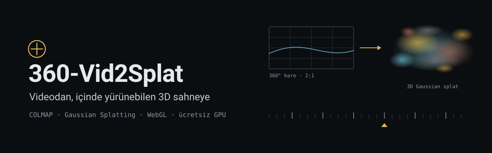
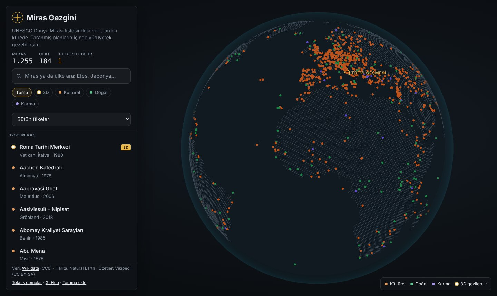
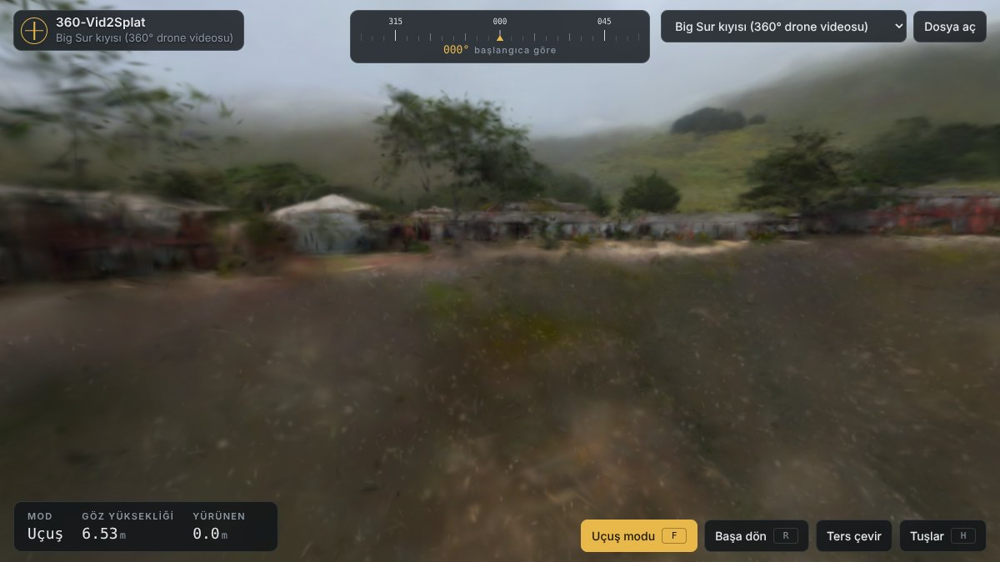
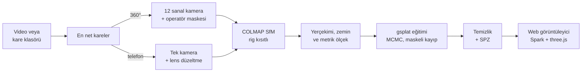

<p align="center">
  
</p>

<p align="center">
  <a href="https://360-vid2splat.vercel.app/"></a>
  <a href="https://colab.research.google.com/github/Oguzhan61-dilmac/360-vid2splat/blob/main/notebooks/vid2splat_colab.ipynb"></a>
  
  
  <a href="LICENSE"></a>
</p>

**Miras Gezgini**, UNESCO Dünya Mirası listesindeki 1.255 alanın tamamını tek bir 3D kürede toplar. 3D taraması olan mirasların içinde **yürüme efektiyle** gezersin: adım sallantısı, ayak sesi, hızlanıp yavaşlama. Taraması olmayan her miras, birinin onu taramasını bekleyen boş bir sayfadır.

Taramaları üreten motor **360-Vid2Splat**: 360° kamerayla ya da telefonla çekilmiş bir videoyu COLMAP ve 3D Gaussian Splatting ile gezilebilir bir sahneye çevirir. Her şey ücretsiz Colab GPU'su ve Vercel üzerinde çalışır.

> *English:* Miras Gezgini puts every UNESCO World Heritage site on one 3D globe and lets you walk through the ones that have been scanned, with head bob and footsteps. Scans come from 360-Vid2Splat, an open-source pipeline (COLMAP + Gaussian Splatting) that turns a 360° or phone video into a walkable scene on free Colab GPUs.

<p align="center">
  
  <br>
  <sub>Ana sayfa: 1.255 UNESCO Dünya Mirası alanı tek kürede. Altın halkalı olanların içinde yürünebiliyor.</sub>
</p>

## Hemen dene

| | |
|---|---|
| **Dünya küresi** · 1.255 UNESCO mirası, arama ve filtre | [360-vid2splat.vercel.app](https://360-vid2splat.vercel.app/) |
| **Her miras 3D arazide** · uydu görüntüsü, gerçek arazi, 3D binalar; dron ya da yürüme | [arazi.html#1018 (Efes)](https://360-vid2splat.vercel.app/arazi.html#1018) |
| **Trevi Çeşmesi** · Roma Tarihi Merkezi, 8 MB, yürüme efektiyle | [360-vid2splat.vercel.app/gez.html#trevi](https://360-vid2splat.vercel.app/gez.html#trevi) |
| **Big Sur kıyısı** · 8K 360° drone videosundan, 133 MB (teknik demo) | [gez.html#big-sur](https://360-vid2splat.vercel.app/gez.html#big-sur) |
| **Kendi videon** · ücretsiz T4 GPU ile | [Colab not defterini aç](https://colab.research.google.com/github/Oguzhan61-dilmac/360-vid2splat/blob/main/notebooks/vid2splat_colab.ipynb) |
| **Bir mirası sen tara** | [Tarama ekleme rehberi](CONTRIBUTING.md) |

Elindeki herhangi bir `.ply`, `.spz`, `.splat`, `.ksplat` ya da `.sog` dosyasını görüntüleyiciye sürükleyip bırakarak da açabilirsin.

## Miras Gezgini

- **Bütün liste tek kürede:** UNESCO Dünya Mirası listesindeki her alan, türüne göre renklendirilmiş bir nokta. Ada, ülkeye ya da türe göre ara; seçtiğin mirasa küre döner.
- **Ayrıntı kartı:** Türkçe ad, ülke, listeye giriş yılı, UNESCO ölçütleri, Türkçe Vikipedi özeti, maddedeki fotoğraflardan bir şerit; UNESCO, Vikipedi ve harita bağlantıları. Wikidata kaydında Vikipedi bağlantısı olmayan mirasların maddesi adıyla aranıp bulunur.
- **Yürüme efekti:** Hızlanıp yavaşlayan yürüyüş, adım başına baş inip kalkması ve yana salınım, her adımda tarayıcıda sentezlenen ayak sesi. Hareket hassasiyeti ayarı açık olanlarda sallantı kapalı başlar; ses `M` ile kapanır.
- **Bütün mirasları gez:** Fotoğraf-gerçekçi taraması olmayan her miras, [`arazi.html`](web/arazi.html)'de Esri uydu görüntüsü, AWS Terrain Tiles arazi yükseltisi ve OpenStreetMap binalarıyla 3D olarak gezilebilir; dron ve göz hizasında yürüme, aynı yürüme efektiyle.
- **Dürüst kapsam:** 3D taraması olan miras sayısı küçük ve sayfada açıkça yazıyor. Taraması olmayan her mirasın kartında "Bu mirası sen tara" düğmesi var.
- **Açık veri:** Miras listesi [Wikidata](https://www.wikidata.org)'dan (CC0) [`scripts/build_sites.py`](scripts/build_sites.py) ile derleniyor; harita Natural Earth (kamu malı).

<p align="center">
  
  <br>
  <sub>Görüntüleyici: 8K 360° drone videosundan üretilmiş Big Sur sahnesi (<a href="https://huggingface.co/datasets/Jamesbass/bigsur-360-colmap">Jamesbass/bigsur-360-colmap</a>, CC BY 4.0)</sub>
</p>

## 360-Vid2Splat: taramaları üreten hat

- **360° ve normal video:** Equirectangular 360° videoyu en-boy oranından tanır. 360 kameran yoksa telefon videosu ya da hazır bir görüntü klasörü de olur.
- **Çeken kişiyi siler:** 360 kamerada her karede görünen operatör, hem kamera konumu hesabında hem eğitimde maskelenir; sahnede hayalet figür kalmaz.
- **Gerçek ölçek:** Sahne yerçekimine hizalanır, zemin bulunur ve metreye ölçeklenir. Görüntüleyicide göz hizasında yürürsün.
- **Bulanık kareleri eler:** Video kısa dilimlere bölünür, her dilimden en net kare seçilir.
- **Web'e hazır çıktı:** Havada asılı "hayalet" Gaussian'lar temizlenir, dosya SPZ biçiminde ~10 kat sıkıştırılır.
- **Gezinti:** WASD ve fare, telefonda dokunmatik çubuk, çekim rotasında otomatik tur, rota haritası ve görünmez duvarlarla sahnenin boş yerlerine düşmeme.

## Nasıl çalışır



| Adım | Dosya | Ne yapar |
|---|---|---|
| Kare seçimi | [`frames.py`](vid2splat/frames.py) | Videoyu 0,5 sn'lik dilimlere böler, her dilimden Laplacian varyansı en yüksek kareyi alır. Netlik sahne içeriğine bağlı olduğu için her dilim sadece komşularıyla kıyaslanır. |
| 360° → sanal kameralar | [`sfm.py`](vid2splat/sfm.py) | Her panoramayı 4 yön × 3 eğimde 90°'lik 12 görüntüye böler ve COLMAP'te sabit bir rig olarak çözer. Kameranın altındaki 35°'lik koni maskelenir. |
| Hizalama | [`align.py`](vid2splat/align.py) | Ortalama "yukarı" yönünü +Y'ye çevirir, kameraların altındaki noktalardan zemini bulur, kamera-zemin mesafesini çekim yüksekliğine eşitleyerek ölçeği hesaplar. |
| Eğitim | [`train.py`](vid2splat/train.py) | gsplat'in kararlı API'siyle sade bir eğitici. MCMC yoğunlaştırma Gaussian sayısını sınırlar; operatör maskesi kayıptan çıkarılır. |
| Dışa aktarma | [`export.py`](vid2splat/export.py) | Şeffaf, aşırı büyük ve yalnız kalmış Gaussian'ları siler, PLY'yi SPZ'ye çevirir. |
| Görüntüleyici | [`web/gez.html`](web/gez.html) | Yürüme efektli 3D görüntüleyici; derleme gerektirmez. |
| Dünya küresi | [`web/index.html`](web/index.html) | Bütün mirasları gösteren keşif sayfası. |

## Kendi videonu işle (Colab, ücretsiz)

1. [Not defterini Colab'da aç](https://colab.research.google.com/github/Oguzhan61-dilmac/360-vid2splat/blob/main/notebooks/vid2splat_colab.ipynb) ve `Çalışma zamanı > Çalışma zamanı türünü değiştir > T4 GPU` seç.
2. Hücreleri sırayla çalıştır: kurulum → video yükle → kamera konumları → eğitim. Toplam yaklaşık 45–60 dakika.
3. Son hücrenin indirdiği zip'i `web/scenes/<sahne>/` klasörüne aç ve [`web/data/scans.json`](web/data/scans.json) listesine ekle. Bir UNESCO mirasıysa `whc` alanına miras numarasını yaz; küre onu 3D gezilebilir olarak işaretler (ayrıntılar [CONTRIBUTING.md](CONTRIBUTING.md)'de).
4. `main` dalına push et; Vercel siteyi bir dakika içinde otomatik olarak yeniden yayınlar.

360 kameran yoksa not defterindeki **"Örnek 360° veri indir"** hücresi, [Big Sur 360 veri setinin](https://huggingface.co/datasets/Jamesbass/bigsur-360-colmap) (CC BY 4.0) panoramalarını indirir.

## İnternet fotoğraflarından miras (video çekmeden)

Ünlü mirasların Wikimedia Commons'ta binlerce serbest lisanslı fotoğrafı var. [MegaScenes](https://megascenes.github.io) veri seti (Tung ve ark., ECCV 2024) bu fotoğrafların kamera konumlarını hesaplayıp herkese açık yayınlıyor. Hat bunları doğrudan kullanabiliyor:

1. [`scripts/megascenes_prep.py`](scripts/megascenes_prep.py) sahnenin en kalabalık bileşeninden en çok noktayı gören fotoğrafları seçer (eski çizimler, iskeleli yıllar, gece çekimleri gibi alt kategorileri atlar), indirir ve lens bozulmasını giderir.
2. Eğitici `--wild` ile çalışır: her fotoğrafa ayrı renk/pozlama düzeltmesi öğrenir ve en çok hata veren piksel bölgelerini (kareye giren turistler, araçlar) kayıptan çıkarır.
3. [`scripts/prepare_megascene.py`](scripts/prepare_megascene.py) ölçeği ve yukarı yönü fotoğrafların kendisinden çıkarır: insanlar fotoğrafı çoğunlukla düz ve göz hizasından çeker. Yürüme rotası, yerdeki fotoğrafçıların durduğu noktalardan oluşur.

[Bu Colab defteri](https://colab.research.google.com/github/Oguzhan61-dilmac/360-vid2splat/blob/main/notebooks/megascenes_colab.ipynb) birden çok mirası arka planda sırayla eğitir (L4 GPU'da sahne başına ~20 dk). Üretilen sahneler fotoğrafların lisansı gereği CC BY-SA 4.0'dır; her sahnenin klasöründeki `credits.json` kullanılan Commons dosyalarını listeler.

### İyi çekim için

- **Yavaş yürü** (normal hızının yarısı) ve kamerayı hep aynı yükseklikte tut.
- 360 kamerayı **görünmez selfie çubuğuyla başının üstünde** tut; yatay sabitleme açık kalsın.
- Hareketli insanlardan, aynalardan, camlardan ve düz beyaz duvarlardan kaçın; doku, kamera konumu hesabının yakıtıdır.
- Aynı yerden iki farklı yönde geçmek (döngü kurmak) sonucu güçlendirir. 1–2 dakikalık video yeterli.
- 360 videoyu kameranın uygulamasından **equirectangular MP4** olarak dışa aktar (5.7K yeterli).

## Yerel kullanım

```bash
git clone https://github.com/Oguzhan61-dilmac/360-vid2splat.git && cd 360-vid2splat
pip install -r requirements.txt          # NVIDIA GPU varsa pycolmap yerine pycolmap-cuda12

# Kamera konumları + hizalama (CPU'da da çalışır)
python -m vid2splat sfm video.mp4 --out output/oda --capture-height 1.7

# Eğitim ve web'e dışa aktarma (NVIDIA GPU + Node.js gerekir)
pip install --no-build-isolation gsplat==1.5.3
python -m vid2splat train output/oda --steps 15000

# Görüntüleyiciyi aç
python -m http.server -d web            # http://localhost:8000
```

<details>
<summary><b>Tüm seçenekler</b></summary>

| Seçenek | Varsayılan | Açıklama |
|---|---|---|
| `--mode` | `auto` | `360`, `perspective` ya da en-boy oranından otomatik |
| `--capture-height` | 360: 1.7, telefon: 1.5 | Kameranın yerden yüksekliği (m); ölçek buradan gelir |
| `--interval` | 0.5 | Kaç saniyede bir kare seçileceği |
| `--every` | 1 | Girdi bir görüntü klasörüyse her kaçıncı görüntünün alınacağı |
| `--max-frames` | 200 | Kare sayısı üst sınırı |
| `--pano-width` | 3840 | 360 karelerin genişliği; sanal görüntüler bunun dörtte biri olur |
| `--nadir-mask` | 35 | 360'ta kameranın altında maskelenen koni (derece); 0 kapatır |
| `--layout` | `overlapping` | `cubemap` ile klasik küp haritası (karşılaştırma için) |
| `--steps` | 15000 | Eğitim adımı; 30000 en iyi kalite |
| `--max-splats` | 1000000 | Gaussian üst sınırı; web dosya boyutunu belirler |
| `--no-floaters` | | Dışa aktarmada hayalet temizliğini kapatır |
| `--cpu` | | GPU olsa bile COLMAP'i CPU'da çalıştırır |

</details>

## Görüntüleyici

| Masaüstü | Telefon | |
|---|---|---|
| `W` `A` `S` `D` / oklar | Sol alttaki çubuk | Yürü |
| Fare (tıklayınca imleç kilitlenir) | Ekranda sürükle | Etrafına bak |
| `Shift` | | Koş |
| `+` / `−` | | Hızı ayarla |
| `F` | Uçuş modu düğmesi | Serbest uçuş (`E` yüksel, `Q` alçal) |
| `T` | Otomatik tur düğmesi | Çekim rotasında gezdirir |
| `R` | Başa dön düğmesi | Başlangıç noktasına döner |
| `M` | Ses düğmesi | Ayak sesini açar / kapatır |

Adres çubuğuyla uzak bir sahne de açılabilir:

- `?splat=<dosya-adresi>&flip=1` tek bir splat dosyası açar. `flip=1`, COLMAP düzeninde gelen, yani ters görünen dosyalar içindir.
- `?scene=<klasör-adresi>` bu hattın ürettiği `scene.json` + `scene.spz` klasörünü açar.

Her iki durumda da dosyanın bulunduğu sunucunun CORS izni vermesi gerekir; Hugging Face veriyor.

## Test sonuçları

Hat, gerçek kamera konumları bilinen sentetik videolarla ölçüldü. [`make_synthetic.py`](tests/make_synthetic.py) dokulu bir oda içinde yürüyen kamera üretir; 360 modunda kameranın altında "çeken kişi" figürü de vardır. Ölçüm [`evaluate.py`](tests/evaluate.py) ile yapılır:

| Test | Konumlandırılan | Ölçek oranı (1 = doğru) | Yukarı yön hatası | Konum hatası (RMSE) |
|---|---|---|---|---|
| 360° video, 10 sn | 24/24 panorama | 0.997 | 0.10° | 0.3 mm |
| Telefon videosu, 10 sn | 24/24 kare | 0.998 | 0.15° | 1.1 mm |
| Big Sur, gerçek 360° drone verisi (20 panorama, CPU) | 20/20 panorama | ölçülmedi | ölçülmedi | 0.35 px yeniden izdüşüm |

Sentetik görüntülerde gürültü olmadığı için bu hatalar gerçek çekimlerdekinden çok düşüktür; amaç geometrinin, maskelemenin ve ölçek tahmininin doğru kurulduğunu göstermek. Eğitim kodu GPU'suz bir duman testinden ([`smoke_train_cpu.py`](tests/smoke_train_cpu.py)) geçiyor; GPU'daki ilk tam eğitim sonuçları buraya eklenecek.

```bash
python tests/make_synthetic.py output/syn360.mp4 --mode 360       # ~6 dk, CPU
python -m vid2splat sfm output/syn360.mp4 --out output/syn360 --capture-height 1.9 --interval 0.4
python tests/evaluate.py output/syn360.json output/syn360
```

## Proje yapısı

```text
360-vid2splat/
├── vid2splat/                 Python işlem hattı (python -m vid2splat)
│   ├── frames.py              en net kare seçimi
│   ├── sfm.py                 360 rig / telefon SfM (pycolmap)
│   ├── align.py               yerçekimi, zemin, metrik ölçek, scene.json
│   ├── train.py               gsplat MCMC eğitimi (maskeli)
│   ├── export.py              hayalet temizliği + SPZ
│   └── pipeline.py            adımları birleştirir
├── web/                       Vercel'de yayınlanan site
│   ├── index.html             dünya küresi (bütün UNESCO mirasları)
│   ├── gez.html               yürüme efektli 3D görüntüleyici
│   ├── data/                  sites.json, scans.json, land-dots.bin
│   └── scenes/                taramalar (scene.spz + scene.json)
├── scripts/                   veri derleme ve tarama hazırlama betikleri
├── notebooks/                 ücretsiz Colab not defteri
├── tests/                     sentetik veri, doğruluk ölçümü, CPU duman testi
├── docs/                      README görselleri
└── vercel.json                Vercel yayın ayarları (sadece web/ sunulur)
```

## Yol haritası

- [x] 360° ve telefon videosundan SfM, operatör maskesi, metrik hizalama
- [x] Ücretsiz Colab eğitimi, SPZ dışa aktarma, web görüntüleyici
- [x] Hazır görüntü klasörleri ve örnek veri setleriyle çalışma
- [x] Miras Gezgini: bütün UNESCO mirasları kürede, yürüme efektli gezinti, ilk tarama (Trevi)
- [ ] Türkiye'deki mirasların taranması: Efes, Kapadokya, Arslantepe, Ani…
- [ ] GPU'da tam eğitim sonuçlarının (PSNR, karşılaştırma görselleri) eklenmesi
- [ ] Hareketli insanları otomatik maskeleme (YOLO-seg / SAM 2)
- [ ] Çekim kalite raporu: "şu bölge az görüldü, tekrar çek" uyarıları
- [ ] Görüntüleyicide çarpışma (zemin ve duvar vokselleri) ve mesafe ölçme
- [ ] GPU'lu bir sunucu bulunduğunda "yükle, bekle, gez" sitesi (FastAPI + iş kuyruğu)

## Katkıda bulunma

Hata bulursan ya da bir fikrin varsa [issue aç](https://github.com/Oguzhan61-dilmac/360-vid2splat/issues). Kod katkıları için kendi dalında çalışıp pull request gönder; işlem hattına dokunan değişikliklerde sentetik testin (`tests/evaluate.py`) sonuçlarını PR açıklamasına eklemen yeterli.

## Teşekkürler

Bu proje şu açık kaynak çalışmaların üzerine kurulu: [COLMAP / pycolmap](https://colmap.github.io) (BSD), [gsplat](https://github.com/nerfstudio-project/gsplat) (Apache 2.0), [Spark](https://sparkjs.dev) (MIT), [three.js](https://threejs.org) (MIT) ve [splat-transform](https://github.com/playcanvas/splat-transform) (MIT). Orijinal INRIA 3DGS kodu ticari olmayan lisanslı olduğu için kullanılmadı.

Trevi Çeşmesi taraması: [WildGaussians](https://huggingface.co/jkulhanek/wild-gaussians) (Kulhanek ve ark., NeurIPS 2024, MIT). Miras listesi: Wikidata (CC0). Özetler ve görseller: Vikipedi ve Wikimedia Commons, kendi lisanslarıyla.

Demo sahneleri: Big Sur, [Jamesbass/bigsur-360-colmap](https://huggingface.co/datasets/Jamesbass/bigsur-360-colmap) (CC BY 4.0); Oda, [Mip-NeRF 360](https://jonbarron.info/mipnerf360/) veri setinden, [cakewalk/splat-data](https://huggingface.co/cakewalk/splat-data) üzerinden.

## Lisans

[MIT](LICENSE) © 2026 Oğuzhan Dilmaç
